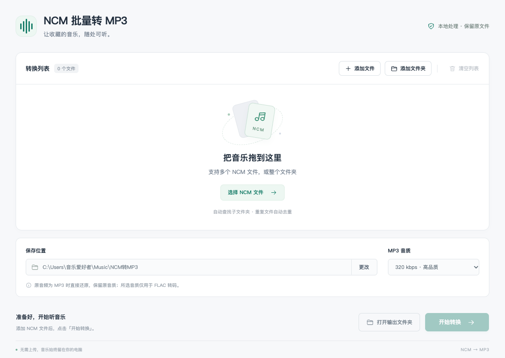

# NCM批量转MP3

支持 Windows 10/11 64 位，以及 macOS 13+ 的 Apple 芯片和 Intel Mac。本地离线处理，完整解压后运行 EXE 或 `.app`，无需另装 Python、Node.js 或 FFmpeg。

**当前验证状态：**59 项转换与流程自动测试已通过，Apple 芯片 Mac 已通过原生界面三文件混合转换验收，界面另有模拟接口检查；尚未完成 Windows 实机验收。测试环境和边界详见 [测试记录](docs/测试记录.md)。

## 下载

在 [Releases](https://github.com/apameda/ncm-mp3-windows/releases/latest) 下载适合你的版本：

| 下载附件 | 适用电脑 |
|---|---|
| `NCM-MP3-Windows-x64.zip` | Windows 10/11 64 位 |
| `NCM-MP3-macOS-arm64.zip` | macOS 13+，Apple 芯片 M 系列 |
| `NCM-MP3-macOS-x64.zip` | macOS 13+，Intel 芯片 |

完整解压后使用。Windows 请保留整个文件夹；Mac 可将 `.app` 移到“应用程序”。`NCM-MP3-Source.zip` 和 GitHub 自动生成的 `Source code` 为源码。



## 使用方法

1. 把整个压缩包解压到一个普通文件夹，例如桌面。不要在压缩包里运行，不要只复制 EXE。
2. Windows 双击 `NCM批量转MP3.exe`；Mac 双击 `NCM批量转MP3.app`。
3. 点击“添加文件”选择多首 NCM，或“添加文件夹”扫描整个音乐文件夹（包含子文件夹）。也可以拖入文件或文件夹。
4. 选择 MP3 保存位置和音质，点击“开始转换”。
5. 完成后点击“打开输出文件夹”。

默认保存至 Windows“音乐”文件夹下的 `NCM转MP3`，也可自行修改。软件会记住上次的保存位置和音质。

## 普通 FLAC

也可直接添加普通 `.flac` 文件或包含 FLAC 的文件夹，按所选音质转换为 MP3，无需先封装为 NCM / QMC。保留可读取的歌曲标签，原始 FLAC 不变；LRC 歌词文本不在转换范围内。

## 转换行为

- 所有音频处理在本机离线完成，软件不上传音乐，不联网获取封面，也不包含账号登录或广告。
- 如果 NCM 内部是 FLAC，则转成 44.1 kHz 的 MP3，可选择 320、256 或 192 kbps，默认 320 kbps。
- 如果内部已经是 MP3，直接还原音频流，保留原来的码率和采样率，避免再次压缩。音质选项仅对 FLAC 转码生效。
- 保留可读取的歌名、歌手、专辑信息。此版本不写入专辑封面。
- 每首歌曲完成后都会检查整段音频能否解码，检查通过才保存成品。
- 原始 NCM 不会删除或修改。重名输出自动另存为 `歌曲 (2).mp3`、`歌曲 (3).mp3`，不会覆盖已有文件。
- 相同源文件自动去重。不同文件夹的同名歌曲会分别保存。
- 单个文件失败后继续处理其他歌曲，失败原因显示在列表中。修复原因后可再次点击开始，已成功的歌曲会自动跳过。
- 点击取消会停止当前歌曲和剩余队列，已完成的 MP3 保留；再次开始可继续处理未完成的文件。
- 超过 10000 首歌曲请分批添加；文件夹内的符号链接不会递归跟随。

## 常见问题

**提示转码工具缺失**：请重新解压整个 ZIP，保持 EXE、DLL 和 resources 文件夹在一起。

**个别 NCM 无法转换**：不完整、损坏或不符合标准 NCM 封装的文件可能失败，重新下载源文件后重试。

**写入失败**：选择自己有写入权限的文件夹，并确认磁盘空间充足。

**首次运行提示**：Windows 未进行应用专用代码签名。Mac 只有本地临时签名，未经过 Apple 开发者签名和公证。如果提示无法验证开发者，请确认来源和校验值，再按 [Apple 官方说明](https://support.apple.com/zh-cn/102445)操作。

## 项目与打包

完整项目的源代码在 `src/`，测试在 `test/`；绿色版内的应用源代码在 `resources/app/src/`。核心使用 Node.js 内建模块，桌面运行环境是 Electron，音频编码工具是 FFmpeg。以下命令适用于完整源代码项目。

```sh
npm test
node scripts/package.mjs --target all
```

打包不需要安装 npm 依赖，Mac App 需要在 macOS 构建；脚本会下载并校验固定版本的官方运行环境和音频工具。详见 `docs/打包说明.md`。开发时可安装开发依赖后运行 `npm start`；在 macOS/Linux 开发时设置 `NCM_FFMPEG` 为本机 FFmpeg 路径。

测试会生成无版权的短测试音频，验证 NCM 还原、转码、完整解码、重名输出和取消。集成测试通过 `NCM_TEST_FFMPEG` 指定本机 FFmpeg；没有可运行工具时会跳过这部分测试。

第三方软件来源和许可见 `THIRD_PARTY_NOTICES.md` 与发行包内的 `licenses/`。

FFmpeg 对应源码与上游构建信息见 [第三方源码指引](docs/第三方源码.md)；绿色版内也附有同名指引。
